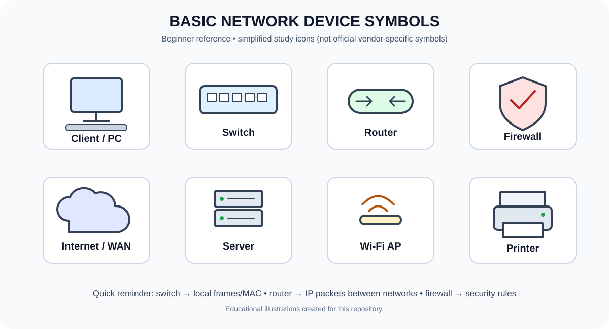

# Day 01 — Network Fundamentals & Network Devices

> **Learning goal:** Understand what a computer network is, identify common network devices, explain how a switch works, distinguish switching from routing, and perform a few safe beginner networking checks.
>
> **Video:** [Jeremy's IT Lab — Free CCNA: Network Devices, Day 1](https://www.youtube.com/watch?v=H8W9oMNSuwo)
>
> **Recommended study time:** 45–60 minutes for reading, video, and practice.



## Contents
- [1. What is a computer network?](#1-what-is-a-computer-network)
- [2. Essential networking vocabulary](#2-essential-networking-vocabulary)
- [3. Common network devices](#3-common-network-devices)
- [4. How a switch works](#4-how-a-switch-works)
- [5. How a router works](#5-how-a-router-works)
- [6. Switch vs router vs firewall](#6-switch-vs-router-vs-firewall)
- [7. Types of networks](#7-types-of-networks)
- [8. What happens when you open a website?](#8-what-happens-when-you-open-a-website)
- [9. Beginner practical lab](#9-beginner-practical-lab)
- [10. Quick revision sheet](#10-quick-revision-sheet)
- [11. Self-test](#11-self-test)
- [12. Glossary](#12-glossary)

---

## 1. What is a computer network?

A **computer network** is two or more devices connected so they can communicate and share data or resources.

Examples:
- A laptop connecting to a home Wi-Fi router.
- Office computers sharing files and printers.
- A web browser communicating with a web server.
- Security devices sending logs to a SIEM such as Splunk.

Networks may use wired connections (such as Ethernet) or wireless connections (such as Wi-Fi).

### Why are networks useful?
1. **Resource sharing:** share printers, files, storage, and applications.
2. **Communication:** email, messaging, calls, and video meetings.
3. **Centralised management:** manage users and computers from services such as Active Directory.
4. **Internet access:** reach websites and cloud applications.
5. **Security monitoring:** collect and investigate network and system events.

## 2. Essential networking vocabulary

| Term | Meaning | Example |
|---|---|---|
| **Node** | A device or connection point in a network | PC, switch, router |
| **Host** | A network-connected device that sends or receives network traffic | Laptop, server |
| **Client** | A device or application that requests a service | Web browser |
| **Server** | A system or application that provides a service | Web server, DNS server |
| **Network interface (NIC)** | The hardware or virtual interface used to connect to a network | Wi-Fi adapter, Ethernet adapter |
| **Link** | A connection between network interfaces | Ethernet cable or wireless link |
| **Protocol** | Agreed rules for communication | TCP, IP, HTTP, DNS |
| **Ethernet frame** | Data unit used at the Ethernet link layer | A frame sent over a LAN |
| **IP packet** | Data unit carried by IP at the network layer | IPv4 packet |
| **MAC address** | Link-layer address used for local delivery on technologies such as Ethernet | `A4:5E:60:12:34:56` |
| **IP address** | Logical address used to identify an interface for IP communication | `192.168.1.10` |
| **Port number** | Identifies a service/application endpoint at the transport layer | TCP port 443 for HTTPS |
| **Bandwidth** | Maximum capacity of a connection over time | 1 Gbps |
| **Latency** | Time delay for data to travel between endpoints | 20 ms |
| **Topology** | How network devices and links are arranged | PCs connected to a switch |

**Important:** MAC addresses and IP addresses do different jobs. A MAC address is used for local link delivery; an IP address supports communication across IP networks. A MAC address is not a universal permanent identity: interfaces may use locally administered or randomized MAC addresses.

## 3. Common network devices

### 3.1 Client and server

A **client** requests a service. A **server** provides it. These are roles, not necessarily different kinds of physical computers.

Example: when you open a website:
1. Your browser acts as a client.
2. It requests resources from a web server.
3. The server processes the request and returns a response.
4. The browser displays the result.

One computer can be a client for one service and a server for another.

**Cybersecurity connection:** A SOC analyst may investigate a client repeatedly contacting an unfamiliar server or external IP. Useful evidence includes destination IP, port, protocol, timestamps, frequency, and endpoint/security logs.

### 3.2 Switch

A **Layer 2 Ethernet switch** connects devices within a LAN or VLAN and forwards Ethernet frames using a **MAC address table**.

Think of it as a smart delivery desk: it learns which device is reachable through which switch port.

Key facts:
- Learns from the **source MAC address** of incoming frames.
- Associates a learned MAC address with the port where the frame arrived (within a VLAN).
- Checks the destination MAC address when deciding where to forward a frame.
- If the destination is known, forwards the frame to the appropriate port.
- If an ordinary unicast destination is unknown, normally floods the frame out eligible ports in the same VLAN, except the incoming port.
- Broadcast frames are normally flooded within the VLAN, subject to switch rules and features.

A switch does not normally learn IP-to-MAC mappings the way a host uses ARP. It learns MAC-to-port information from Ethernet frames.

### 3.3 Router

A **router** connects different IP networks and forwards IP packets toward their destinations.

A router:
1. Receives an IP packet.
2. Reads the destination IP address.
3. Checks its routing table.
4. Selects the best matching route.
5. Forwards the packet through the chosen interface or next hop.

A **default gateway** is the router (or Layer 3 device) a host normally sends traffic to when the destination is outside its local subnet.

Example:
- LAN A: `192.168.1.0/24`
- LAN B: `192.168.2.0/24`
- A router with interfaces in both networks can route traffic between them, if configured appropriately.

### 3.4 Firewall

A **firewall** enforces network traffic security policy. Depending on its capabilities, rules may consider:
- Source and destination IP addresses.
- Source and destination ports.
- Protocol (TCP, UDP, ICMP, etc.).
- Connection state.
- Application, user, or threat information.

Example: a rule may allow approved outbound HTTPS connections but block unsolicited inbound connections.

A firewall may log allowed or blocked traffic. SOC analysts use these logs to investigate suspicious connections, repeated denied traffic, scanning activity, and possible command-and-control communications.

### 3.5 Internet / WAN

The **Internet** is a global network of interconnected networks. A **WAN (Wide Area Network)** connects networks across larger geographic areas, such as between company branches. The Internet is one example of a global internetwork, but not every WAN is the public Internet.

### 3.6 Wireless access point (AP)

A **wireless access point** allows Wi-Fi devices to connect to a network. In many homes, the access point is built into the wireless router. In enterprises, access points may be separate devices.

### 3.7 Modem (basic idea)

A modem provides a connection over a service provider's access technology (for example, cable or DSL). Fiber services may use an optical network terminal (ONT). Home networking devices may combine several roles in one box.

### 3.8 Other common devices

- **NIC:** Network interface in a computer or device.
- **Repeater/extender:** Regenerates or extends a signal/link, depending on technology.
- **Bridge:** Connects Layer 2 network segments; a traditional switch can be understood as a multiport bridge.
- **Load balancer:** Distributes client requests across multiple servers.
- **IDS:** Detects suspicious activity and generates alerts.
- **IPS:** Can detect and actively block/prevent selected traffic, typically inline.
- **Proxy:** Intermediary that makes requests on behalf of a client or server, often for control, privacy, caching, or inspection.

## 4. How a switch works

Imagine PC-A, PC-B, and PC-C connected to the same Ethernet switch.

Example addressing:
- PC-A IP: `192.168.1.10/24`
- PC-B IP: `192.168.1.20/24`
- PC-C IP: `192.168.1.30/24`

These example IP addresses are in the same IPv4 subnet. For two PCs to communicate through a Layer 2 switch, their IP configuration and VLAN connectivity must be appropriate.

### Step 1 — A frame arrives

PC-A sends an Ethernet frame into the switch. The frame has a **source MAC address** (PC-A's interface) and a **destination MAC address** (PC-B's interface, assuming PC-A already knows it).

### Step 2 — The switch learns the source

The switch looks at the source MAC address and records which port the frame came in on. This information is stored in the **MAC address table**, also called the forwarding database or CAM table.

Illustrative table:

| Learned MAC address | Port |
|---|---|
| AA:AA:AA:AA:AA:AA | Port 1 |
| BB:BB:BB:BB:BB:BB | Port 2 |
| CC:CC:CC:CC:CC:CC | Port 3 |

The table is learned dynamically and entries can age out. Real switches also keep VLAN context and other forwarding information.

### Step 3 — The switch checks the destination

The switch looks up the destination MAC address in the table:
- **Known destination:** forward the frame out the corresponding port (within the relevant VLAN).
- **Unknown unicast destination:** flood it out eligible ports in the VLAN, excluding the incoming port.
- **Broadcast destination:** normally flood it within the VLAN, excluding the incoming port.

### Step 4 — The destination receives the frame

If PC-B is connected to the destination port, the frame reaches PC-B. Other ports are not sent a known unicast frame under ordinary switching behavior.

### Step 5 — The switch learns as communication continues

When PC-B replies, the switch learns PC-B's source MAC and port too. Future frames can be forwarded directly to the learned destination port.

### What if PC-A knows PC-B's IP but not its MAC?

For IPv4 on a local Ethernet network, PC-A may use **ARP (Address Resolution Protocol)** to discover the MAC address associated with PC-B's local IP address. PC-A sends an ARP request as a broadcast; the device with the matching IPv4 address normally replies with its MAC address. Then PC-A can build the Ethernet frame.

If PC-B is outside PC-A's local subnet, PC-A normally resolves the MAC address of its **default gateway**, not the remote host. We will study ARP and subnetting in a later lesson.

### Switch interview answer

> A Layer 2 switch learns source MAC addresses from incoming Ethernet frames and maps them to switch ports in its MAC address table. It uses the destination MAC to forward known unicast frames to the correct port. If the unicast destination is unknown, it normally floods the frame within the VLAN, except the incoming port.

## 5. How a router works

A router makes forwarding decisions based on the destination IP address and its routing table.

Example:
- PC-A is in `192.168.1.0/24`.
- A server is in `192.168.2.0/24`.
- The router has a connected interface in each subnet.

PC-A sees the server's IP is outside its own subnet and sends the packet to its default gateway. The router looks up the destination, chooses a route, and forwards the packet toward the server's network.

At each routed hop, the Layer 2 frame used on a link is normally replaced for the next link; the IP packet is forwarded onward, with fields such as TTL (IPv4) or Hop Limit (IPv6) updated by routers.

**Switch vs router:**
- Switch: usually forwards Layer 2 Ethernet frames using MAC addresses.
- Router: forwards Layer 3 IP packets using IP routing information.
- Layer 3 switches can also route between IP networks.

## 6. Switch vs router vs firewall

| Device | Main purpose | Key information used |
|---|---|---|
| Layer 2 switch | Connects devices within a LAN/VLAN | MAC address table |
| Router | Connects IP networks | Routing table and destination IP |
| Firewall | Enforces traffic security policy | Configured rules; may inspect IPs, ports, state, applications, and more |
| Access point | Connects wireless clients to a network | Wi-Fi association and wireless forwarding |
| Server | Provides a network service | Application/service configuration |
| Client | Requests a network service | Client application and network configuration |

These are functional roles. A single physical home gateway may include a router, firewall, switch, and wireless access point.

## 7. Types of networks

| Type | Meaning | Example |
|---|---|---|
| PAN | Personal Area Network | Phone and Bluetooth earbuds |
| LAN | Local Area Network | Home or office network |
| WLAN | Wireless LAN | Wi-Fi network |
| MAN | Metropolitan Area Network | Network spanning a city |
| WAN | Wide Area Network | Connecting company sites over large distances |

A WLAN is a kind of LAN. Network categories can overlap; they describe different characteristics such as coverage or access technology.

## 8. What happens when you open a website?

Here is a simplified view of opening an HTTPS website from a laptop:

1. **Connection:** The laptop connects to the LAN through Wi-Fi or Ethernet.
2. **Address configuration:** It uses an IP address, subnet mask/prefix, default gateway, and DNS resolver (often configured automatically by DHCP).
3. **DNS lookup:** The client resolves the website name to an IP address, if a usable result is not already cached.
4. **Local delivery decision:** The computer checks whether the destination is local or remote. For a remote destination, it sends traffic toward its default gateway.
5. **Local link addressing:** It uses ARP for IPv4 (or Neighbor Discovery for IPv6) when it needs the next-hop link-layer address.
6. **Switching:** A LAN switch forwards Ethernet frames within the VLAN.
7. **Routing and filtering:** Routers forward IP packets toward the destination. Firewalls along the path may permit, log, or block traffic.
8. **Transport and encryption:** HTTPS typically uses TCP with TLS, or HTTP/3 over QUIC/UDP. The server responds and the browser renders the page.

The Internet path may involve many routers, networks, and security devices. The home router may also perform NAT, but NAT and routing are different functions.

## 9. Beginner practical lab

Use your own computer and networks you are authorized to test.

### Lab A — View your IP configuration (Windows)

Open Command Prompt or PowerShell:

```powershell
ipconfig
```

Find:
- IPv4 address
- Subnet mask
- Default gateway

Then run:

```powershell
ipconfig /all
```

Find the physical address (MAC address) for the active Wi-Fi or Ethernet adapter.

### Lab B — Test the local TCP/IP stack

```powershell
ping 127.0.0.1
```

This uses the IPv4 loopback address to test the local TCP/IP stack. It does not test your physical network cable, Wi-Fi, router, or Internet connection.

### Lab C — Test external IP reachability

```powershell
ping 8.8.8.8
```

This tests ICMP reachability to a public IP address. Some networks or hosts block ICMP, so a failed ping alone does not prove that Internet access is unavailable.

### Lab D — View the routing table

```powershell
route print
```

Look for the IPv4 default route, often shown with network destination `0.0.0.0` and netmask `0.0.0.0`. The gateway listed for that route is typically the default gateway.

### Lab E — Build a tiny network in Cisco Packet Tracer

1. Place one switch and two PCs.
2. Connect each PC to the switch.
3. Configure PC-A with IP `192.168.1.10`, subnet mask `255.255.255.0`.
4. Configure PC-B with IP `192.168.1.20`, subnet mask `255.255.255.0`.
5. From PC-A, open Command Prompt and run:

```text
ping 192.168.1.20
```

Expected result: the PCs should be able to communicate if the links and addressing are correct. The first ping may time out while address resolution occurs, so try again. No router is required for this simple same-subnet lab.

**Observe:** Use Packet Tracer's Simulation mode to watch ARP and ICMP traffic. Try sending traffic again after the MAC address tables and ARP caches have been populated.

## 10. Quick revision sheet

- **Network:** connected devices that communicate and share resources.
- **Client:** requests a service.
- **Server:** provides a service.
- **Switch:** connects devices within a LAN/VLAN; a Layer 2 switch forwards Ethernet frames using MAC addresses.
- **MAC address table:** maps learned MAC addresses to switch ports (within VLAN context).
- **Unknown unicast:** normally flooded within the VLAN, except the incoming port.
- **Router:** forwards IP packets between networks using a routing table.
- **Default gateway:** next-hop router used for off-subnet destinations.
- **Firewall:** enforces traffic security policy.
- **Access point:** connects Wi-Fi clients to a network.
- **IP address:** logical network-layer address.
- **ARP:** maps a local IPv4 next-hop address to a link-layer address on Ethernet.
- **Bandwidth:** capacity; **latency:** delay.
- **LAN:** local network; **WAN:** wide-area network.

### Common beginner mistakes

1. Saying a Layer 2 switch forwards based on IP addresses — it normally forwards Ethernet frames using MAC addresses.
2. Saying a router uses MAC addresses to choose a remote network — routing decisions are based on IP prefixes and the routing table.
3. Assuming a router, firewall, modem, and access point must always be separate boxes — home gateways often combine these roles.
4. Assuming a failed ping always means the network is down — ICMP may be filtered.
5. Assuming the switch learns its MAC table from ARP — it learns source MAC addresses from incoming frames; ARP is a separate IPv4 address-resolution process.

## 11. Self-test

Try answering without looking at the notes.

1. What is a computer network?
2. What is the difference between a client and a server?
3. Which table does a Layer 2 switch use to forward Ethernet frames?
4. How does a switch learn a MAC address?
5. What happens when the switch receives a frame for an unknown unicast destination?
6. What is the main difference between a switch and a router?
7. What is a default gateway?
8. What does a firewall do?
9. What is the purpose of ARP?
10. Which Windows command displays IP configuration?

<details>
<summary>Show answers</summary>

1. Two or more connected devices that communicate and share resources.
2. A client requests a service; a server provides one.
3. The MAC address table / forwarding database.
4. By inspecting the source MAC address of an incoming frame and recording the incoming port (and VLAN context).
5. It normally floods the frame to eligible ports in that VLAN except the incoming port.
6. A Layer 2 switch forwards Ethernet frames within a LAN/VLAN using MAC addresses; a router forwards IP packets between networks using a routing table.
7. The next-hop router used to reach destinations outside the local subnet.
8. It permits or blocks traffic according to security policy.
9. For IPv4 on Ethernet, ARP discovers the link-layer address associated with a local IPv4 next hop.
10. `ipconfig`.

</details>

## 12. Glossary

- **ARP:** Address Resolution Protocol.
- **CAM table:** Common name for switch forwarding table hardware/logic; used to store MAC forwarding entries.
- **DNS:** Domain Name System; resolves names to records such as IP addresses.
- **Ethernet:** A widely used wired LAN technology.
- **ICMP:** Internet Control Message Protocol; used by tools such as ping.
- **IP:** Internet Protocol; provides logical addressing and packet forwarding.
- **LAN:** Local Area Network.
- **MAC:** Media Access Control; part of the data-link layer terminology.
- **NIC:** Network Interface Card/controller.
- **Packet:** Informal term for a unit of network-layer data, especially an IP packet.
- **Port:** Can mean a physical switch/router interface, or a transport-layer service number. Context matters.
- **TCP:** Transmission Control Protocol; reliable, connection-oriented transport.
- **UDP:** User Datagram Protocol; connectionless transport.
- **VLAN:** Virtual LAN; a logical Layer 2 broadcast domain.
- **WAN:** Wide Area Network.

---

## Learning checklist

- [ ] I can explain what a network is.
- [ ] I can distinguish clients and servers.
- [ ] I can explain how a switch learns and forwards MAC addresses.
- [ ] I can distinguish switching, routing, and firewall filtering.
- [ ] I can find my IP address, MAC address, and default gateway.
- [ ] I completed the two-PC Packet Tracer lab.
- [ ] I can answer the self-test questions.

**Next lesson:** Ethernet, MAC addresses, ARP, and communication inside a LAN.
